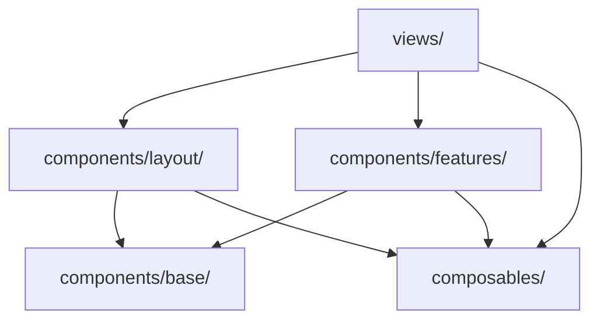

# ADR 02: Komponenten- und Ordnerarchitektur

* **Status:** Akzeptiert
* **Datum:** 2026-10-18
* **Beteiligte:** Christian Fally, Jakob Pronebner

---

## 1. Kontext

Für die Konferenzplattform „Linie F“ wird vor Beginn der Feature-Entwicklung eine Komponenten- und Verzeichnisstruktur benötigt, welche in den Schritten 2 bis 4 ohne Umbau tragfähig bleibt. Die Plattform umfasst drei Seitentypen (Programmübersicht, Session-Detailseite, persönliches Programm), wird von zwei Personen entwickelt und soll die Design Tokens aus Dokument 01 konsequent nutzen.

Für die Bewertung der Optionen wurden folgende Kriterien herangezogen:

* **K1 Wiederverwendbarkeit:** Können generische UI-Elemente ohne Duplikation mehrfach genutzt werden?
* **K2 Token-Anbindung:** Gibt es eine klare Stelle, an der die Design Tokens in Komponenten übersetzt werden?
* **K3 Abhängigkeitsrichtung:** Ist eindeutig geregelt, welche Teile welche anderen importieren dürfen?
* **K4 Aufwand bei Projektgröße:** Passt der Strukturierungsaufwand zu einem Zwei-Personen-Projekt mit überschaubarem Umfang?

## 2. Betrachtete Optionen

### Option A: Feature-basierte Struktur mit `shared/`

Komponenten, Composables und Views werden nach Fachdomäne gebündelt (`features/program/`, `features/my-schedule/`). Generische Bausteine liegen in einem gemeinsamen `shared/`-Ordner.

* **Vorteile:** Hohe Kohäsion, da alle Teile eines Features an einer Stelle liegen. Skaliert gut, wenn mehrere Teams an getrennten Features arbeiten.
* **Nachteile:** Bei Linie F überschneiden sich die Features stark. Die Session-Karte wird sowohl in der Programmübersicht als auch in „Mein Programm“ benötigt und müsste daher nach `shared/` wandern. Dadurch wächst `shared/` zu einem Sammelbecken ohne innere Ordnung, wodurch der eigentliche Vorteil der Feature-Bündelung verloren geht.

### Option B: Schichtenarchitektur (Base, Feature, Layout)

Komponenten werden nach Abstraktionsgrad getrennt: `base/` für generische UI-Primitives, `features/` für Komponenten mit Konferenzlogik, `layout/` für die Seitenstruktur. Geteilte Logik liegt in `composables/`.

* **Vorteile:** Klare Abhängigkeitsrichtung, `base/` als eindeutige Andockstelle für Tokens.
* **Nachteile:** Die Teile eines Features sind über mehrere Ordner verteilt, was bei sehr großen Projekten unübersichtlich wird.

### Option C: Atomic Design

Einteilung in Atoms, Molecules, Organisms, Templates und Pages.

* **Vorteile:** Sehr feine Granularität, verbreitet in Design-System-Projekten.
* **Nachteile:** Die Zuordnung ist oft nicht eindeutig (ist eine Session-Karte ein Molecule oder ein Organism?), was laufend Abstimmungsaufwand erzeugt. Für unseren Umfang sind fünf Ebenen zu viel.

### Bewertung

| Kriterium | A: Feature + shared | B: Schichten | C: Atomic Design |
| :--- | :--- | :--- | :--- |
| K1 Wiederverwendbarkeit | mittel | hoch | hoch |
| K2 Token-Anbindung | mittel (`shared/`) | hoch (`base/`) | hoch (Atoms) |
| K3 Abhängigkeitsrichtung | mittel | hoch | mittel |
| K4 Aufwand bei Projektgröße | mittel | gering | hoch |

## 3. Entscheidung

Wir entscheiden uns für **Option B (Schichtenarchitektur)**. Für die Abhängigkeiten gilt folgende Regel:



`base/`-Komponenten importieren weder Features noch Composables und erhalten alle Daten über Props und Slots.

### Headless-Aufteilung: wo ja, wo bewusst nicht

**Ja: „Zum Programm hinzufügen“.** Die Logik liegt im Composable `useSchedule`, die Darstellung in austauschbaren Komponenten. Der Vorteil ist konkret, da derselbe Zustand an mehreren Stellen mit unterschiedlicher Darstellung benötigt wird: als Zähler im `AppHeader` (bereits umgesetzt), als Liste in `MyScheduleView` (bereits umgesetzt), als Toggle auf der Session-Karte und auf der Detailseite (Schritt 2). Weiters lässt sich die Logik ohne DOM testen.

**Nein: `BaseBadge`, `BaseCard`.** Diese Komponenten haben keine eigene Logik, ein Composable wäre reiner Selbstzweck.

**Vorerst nein: Session-Filter.** Der Filterzustand wird nur in der Programmübersicht und dort in genau einer Darstellung benötigt. Sollte der Filter später in der URL gespeichert oder in einer zweiten Ansicht wiederverwendet werden, wird er in ein Composable `useSessionFilter` ausgelagert.

## 4. Konsequenzen

* **Positiv:** Komponenten bleiben klein, Tokens werden zentral in `base/` umgesetzt, und Redesigns betreffen vorwiegend die Base-Schicht.
* **Negativ:** Ein neues Feature erfordert Änderungen in mehreren Ordnern. Weiters muss im Review darauf geachtet werden, dass keine Konferenzlogik in `base/` landet.

## 5. Ordnerstruktur

```text
src/
├── components/
│   ├── base/          # generische UI-Primitives (nur Props/Slots, nur Tokens)
│   ├── features/      # Komponenten mit Konferenzlogik
│   └── layout/        # Seitenrahmen
├── composables/       # geteilte Logik und geteilter State
├── data/              # conference-data.json
├── types/             # TypeScript-Typen des Datensatzes
├── views/             # eine Komponente je Route
├── router/            # Routendefinitionen
├── assets/main.css    # globale Basis-Styles
└── main.ts
tokens/tokens.css      # Design Tokens (außerhalb von src, siehe Dokument 01)
```

## 6. Komponentenübersicht

| Schicht | Komponente | Verantwortung | Stand |
| :--- | :--- | :--- | :--- |
| Layout | `AppHeader.vue` | Branding, Navigation, Zähler „Mein Programm“ | umgesetzt |
| Layout | `AppFooter.vue` | Fußzeile | umgesetzt |
| Base | `BaseBadge.vue` | Badge mit frei wählbarer Farbe (z. B. Track-Linie) | umgesetzt |
| Base | `BaseCard.vue` | Container-Karte | umgesetzt |
| Base | `BaseButton.vue` | Button-Varianten (Primary, Secondary, Ghost) | Schritt 2 |
| Feature | `TrackOverview.vue` | Tracks als Linien mit Session-Anzahl | umgesetzt |
| Feature | `SessionCard.vue` | Darstellung einer Session, bettet `BookmarkToggle` ein | Schritt 2 |
| Feature | `BookmarkToggle.vue` | Merken/Entfernen, nutzt `useSchedule` | Schritt 2 |
| Feature | `SessionFilter.vue` | Filter nach Track, Tag, Level, Format | Schritt 2 |
| View | `HomeView.vue` | Programmübersicht | Platzhalter |
| View | `SessionDetailView.vue` | Detailseite einer Session | Platzhalter |
| View | `MyScheduleView.vue` | persönliches Programm | Platzhalter |
| Composable | `useConferenceData.ts` | Laden und Bereitstellen des Datensatzes | umgesetzt |
| Composable | `useSchedule.ts` | Headless-Logik „Mein Programm“ | umgesetzt |
