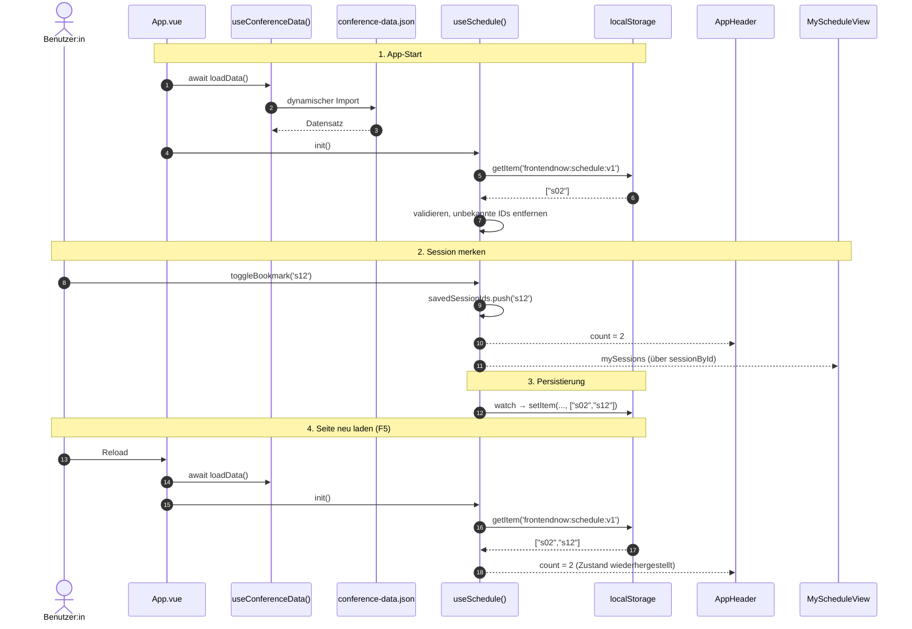

# 03 – State-Management-Konzept: Konferenzdaten & „Mein Programm“

## 1. Laden des Datensatzes: `useConferenceData()`

Der Datensatz `conference-data.json` ist normalisiert: Sessions verweisen über `trackId`, `roomId` und `speakerIds` auf Tracks, Räume und Speaker. Das Composable `useConferenceData()` (`src/composables/useConferenceData.ts`) lädt den Datensatz und stellt ihn allen Komponenten bereit.

* **Geteilter Zustand:** Der Zustand liegt im Modul-Scope, also außerhalb der exportierten Funktion. Jede Komponente, die `useConferenceData()` aufruft, erhält dieselben Referenzen.
* **Einmaliges Laden:** `loadData()` lädt die Datei per dynamischem Import, wodurch sie als eigener Chunk asynchron nachgeladen wird. Ein gemerktes Promise verhindert, dass mehrere gleichzeitige Aufrufe mehrere Ladevorgänge auslösen. `isLoading` und `error` werden im Template für Lade- und Fehlerzustände verwendet.
* **`shallowRef`:** Da der Datensatz zur Laufzeit unverändert bleibt, wird auf tiefe Proxy-Reaktivität verzichtet.
* **Lookups:** Über `computed`-Maps (`sessionById`, `trackById`, `roomById`, `speakerById`) werden die ID-Referenzen in Komponenten aufgelöst. Als einzige Quelle für die Zuordnung Session zu Speaker dient `session.speakerIds`, das redundante Feld `speaker.sessionIds` wird nicht verwendet.

## 2. Datenstruktur von „Mein Programm“: nur IDs

Im State und im `localStorage` werden ausschließlich Session-IDs (`string[]`) gespeichert, keine vollständigen Session-Objekte. Dieses Prinzip entspricht dem bereits normalisierten Datensatz.

1. **Single Source of Truth:** Ändern sich Raum, Uhrzeit oder Titel im Datensatz, zeigt „Mein Programm“ automatisch die aktuellen Werte, da die Objekte zur Laufzeit über die IDs abgeleitet werden.
2. **Geringer Speicherbedarf:** Gespeichert wird z. B. `["s02","s12"]` statt vollständiger Objekte.
3. **Bereinigung:** IDs, welche im Datensatz nicht mehr existieren, werden bei der Rehydration entfernt, sodass keine Altlasten im Speicher verbleiben.

## 3. Reaktivität, Persistierung und Rehydration: `useSchedule()`

`useSchedule()` (`src/composables/useSchedule.ts`) ist ein Headless-Composable ohne eigene Darstellung.

* **Zustand:** `savedSessionIds = ref<string[]>([])` im Modul-Scope.
* **Rehydration:** `init()` liest den Schlüssel `frontendnow:schedule:v1` aus dem `localStorage`. Das Ergebnis von `JSON.parse` wird geprüft: Nur ein Array aus Strings wird übernommen, Duplikate und unbekannte IDs werden verworfen. Fehlerhafte Daten führen zu einer leeren Liste statt zu einem Absturz. Das Suffix `v1` erlaubt eine spätere Migration, falls sich das Format ändert.
* **Persistierung:** Ein `watch` mit `deep: true` schreibt jede Änderung zurück, da `push` und `splice` das Array mutieren, ohne die Referenz zu ersetzen. Der `watch` liegt bewusst im Modul-Scope und nicht in einer Komponente, da Vue ihn sonst beim Unmount dieser Komponente stoppen würde.
* **Toggle:** `toggleBookmark(id)` entfernt eine bereits gemerkte ID und fügt eine neue hinzu, wodurch keine Duplikate entstehen.
* **Abgeleiteter Zustand:** `mySessions` liefert die vollständigen Sessions chronologisch sortiert, `count` die Anzahl und `conflicts` alle Paare gemerkter Sessions, welche sich zeitlich überschneiden.

## 4. Ladereihenfolge und Verteilung

`App.vue` ruft beim Start zuerst `await loadData()` und danach `init()` auf, damit die Bereinigung unbekannter IDs auf vollständige Daten zugreifen kann. Da beide Composables geteilten Zustand halten, aktualisieren sich alle Konsumenten gleichzeitig: aktuell der Zähler in `AppHeader` und die Liste in `MyScheduleView`, ab Schritt 2 zusätzlich `BookmarkToggle` auf Karten und Detailseite.

## 5. Datenfluss- und Rehydrationsdiagramm

